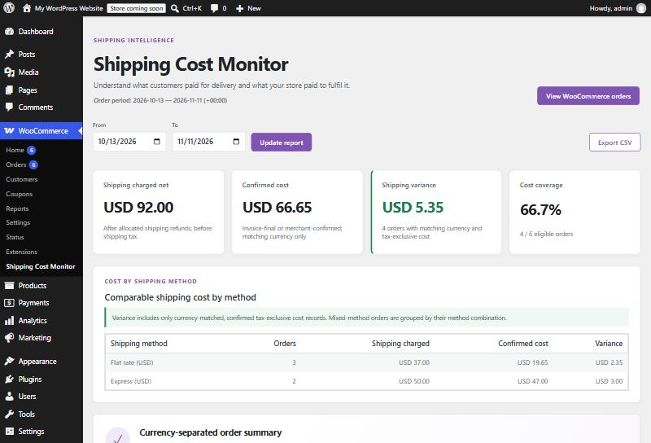
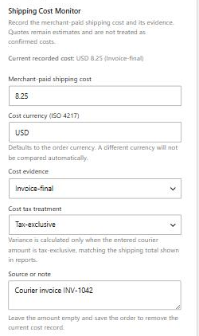

# Shipping Cost Monitor for WooCommerce

**Know what every order really cost to ship, and whether shipping makes or loses you money.**

Shipping Cost Monitor records what you paid the courier for each WooCommerce order and compares it with what the customer paid for shipping. It only counts costs you can prove, keeps currencies and tax treatment apart, and never sends customer data anywhere.

By [WPEssential](https://wpessential.org) · Version **1.0.0** · GPLv2 or later



## Features

### Free

- **Cost record on every order**: amount, currency, evidence type, tax treatment and a source note, in the WooCommerce order editor. Every change is logged as a private order note.
- **Dashboard**: shipping charged (after refunds), confirmed cost, variance and cost coverage for any period up to 366 days.
- **Cost by shipping method**: find which methods lose money, worst first.
- **Evidence-aware totals**: only invoice-final or merchant-confirmed, tax-exclusive, same-currency costs are compared. Quotes and label prices are shown but never counted as real cost.
- **Privacy-minimized CSV export**: no customer names, addresses or emails.
- **HPOS compatible**: all order access goes through WooCommerce CRUD APIs.
- **No external calls.**

### Pro add-on

- **Courier invoice CSV import**: read in your browser (the file is never uploaded), map columns once, save the mapping for next month.
- **Exact order matching**: duplicate, ambiguous, currency, refund and existing-cost checks before anything is saved. Existing costs are never overwritten, and re-importing the same file is safe.
- **ShipStation V2 label costs**: read-only, with the API key encrypted at rest. Label prices are kept as booked-label evidence until the invoice confirms them.



## Requirements

| | Minimum |
|---|---|
| WordPress | 7.0 |
| WooCommerce | 11.2 |
| PHP | 8.1 |

## Installation

1. Download `shipping-cost-monitor-for-woocommerce.zip` (see [Building](#building) for test builds).
2. In WordPress go to **Plugins → Add New → Upload Plugin**, upload the ZIP and activate it.
3. Open **WooCommerce → Shipping Cost Monitor**.
4. For Pro, upload `shipping-cost-monitor-pro-for-woocommerce.zip` the same way. It needs the free plugin.

Full walkthrough: see the built-in documentation (below).

## Documentation

The user guide ships inside the plugin. Open it from **Plugins → Shipping Cost Monitor for WooCommerce → Documentation**, or with the **Documentation** button on the dashboard (**WooCommerce → Shipping Cost Monitor**). It explains every screen, field and number, with screenshots and a worked example, in nine chapters: install and first run; key ideas (evidence, tax basis and currency); recording a cost; reading the dashboard; CSV export; Pro invoice import; Pro ShipStation label costs; troubleshooting; and developer hooks.

The same guide is published on the [GitHub wiki](https://github.com/Vertex-Systems-Network/shipping-cost-monitor-for-woocommerce/wiki). The chapters are HTML files in `assets/docs/`, with screenshots in `assets/docs/images/`. Edit those files to change the guide.

## Repository layout

```
shipping-cost-monitor-for-woocommerce.php   Free plugin bootstrap
includes/                                   Free PHP classes (PSR-4, WPEssential\ShippingCostMonitor)
assets/                                     Free admin CSS and JavaScript (wp.element, no build step); docs/ holds the built-in user guide
readme.txt, changelog.txt, LICENSE          WordPress.org files for the free plugin
docs/                                       Product, architecture, QA gates and project records
.github/                                    CI workflow and the Free/Pro contract check (shared with the Pro repository)
```

## Building

There is no local build step. Free and Pro live in two repositories, and the same GitHub Actions workflow in each builds **both** plugins:

- Free: this repository
- Pro: `Vertex-Systems-Network/shipping-cost-monitor-pro-for-woocommerce` (private). Pro works only when the free plugin is installed.

1. Open **Actions → Build installable plugin ZIPs (Free + Pro)** and click **Run workflow**, or push. Pull requests build too.
2. The run checks out this repository and the other one. If the other repository has a branch with the same name, it uses that branch; otherwise it uses `main`. It then:
   - checks the Free/Pro contract (the hooks, constants, script handle and JavaScript globals Pro relies on)
   - lints PHP 8.1–8.4 and generates each plugin's Composer autoloader
   - checks that versions match and that Free contains no Pro code
   - uploads `shipping-cost-monitor-for-woocommerce-<free commit>`. The paid Pro ZIP is uploaded only by runs in the private Pro repository, so it is never downloadable from this public repository (F-12). This repository reads the private Pro code with a read-only token saved as the `SCM_CROSS_REPO_TOKEN` secret.
3. Download an artifact and upload that downloaded file directly in **Plugins → Add New → Upload Plugin**. Do not unzip it first: GitHub's artifact ZIP already contains the plugin folder. Install Free first. Each plugin folder contains `SHA256SUMS`, the SHA-256 of every packaged file; after unzipping, run `sha256sum -c SHA256SUMS` inside the folder. The run summary shows the SHA-256 of each manifest. Artifacts are kept for 14 days.

Installing the raw repository instead of a built ZIP shows a notice, because `vendor/` is generated by CI.

## Project status

Version 1.0.0 code is complete for both editions. Release QA is tracked in [docs/PHASE-7-GATES.md](docs/PHASE-7-GATES.md), the authoritative register; in short:

- Passed for their stated scope: install and dashboard on WordPress 7.0–7.1 / WooCommerce 11.2 / PHP 8.1–8.4, HPOS and legacy order storage, reconciliation edge cases, Plugin Check (0 errors).
- Still open: an independent security review, performance at 1,000 and 10,000 orders, a merchant beta, and a ShipStation test with a real account.

Not yet submitted to WordPress.org or WooCommerce.com; see the [submission checklist](docs/SUBMISSION-STRATEGY.md#submission-readiness-checklist). Earlier dated status notes are archived in [docs/STATUS-HISTORY.md](docs/STATUS-HISTORY.md).

## Contributing

This repository is developed by AI contributors under recorded decisions. Start with [AGENTS.md](AGENTS.md); decisions are in [docs/OWNER-DECISION-REGISTER.md](docs/OWNER-DECISION-REGISTER.md).

## License

GPL-2.0-or-later. See [LICENSE](LICENSE).
