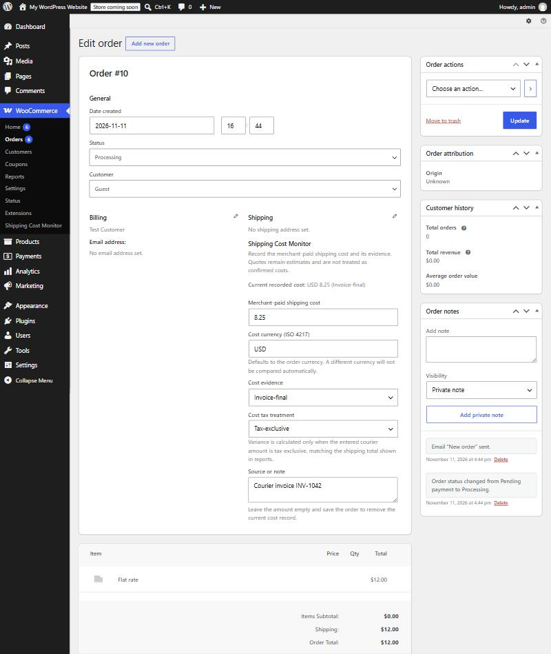
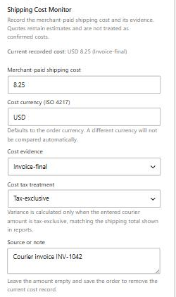

# 3. Recording a cost on an order

[← Guide contents](README.md)

The free plugin adds a **Shipping Cost Monitor** section to every order's edit screen, under the shipping address.

## Step by step

1. Go to **WooCommerce → Orders** and open the order.
2. Find **Shipping Cost Monitor** in the right-hand column of the order details.
3. Fill in the fields below.
4. Click **Update** (top right, in **Order actions**). The cost is saved only when the order is saved.

## Every field

| Field | What to enter | Example | Rules |
|---|---|---|---|
| **Current recorded cost** | Read-only line showing what is saved now. | `USD 8.25 (Invoice-final)` | Absent until a cost is saved. |
| **Merchant-paid shipping cost** | What you paid the courier for this order, as a plain number. | `8.25` | Digits and one decimal point only. No currency symbol, no thousands separator, no minus sign. Leave empty and save to delete the record. |
| **Cost currency (ISO 4217)** | The three-letter currency code of the bill. | `USD` | Pre-filled with the order currency. Must be a currency WooCommerce knows. A different currency is saved but not compared. |
| **Cost evidence** | Where the number came from. | `Invoice-final` | See [evidence](02-key-ideas.md#rule-1-evidence--how-sure-is-this-number). Only Invoice-final and Merchant-confirmed count. |
| **Cost tax treatment** | Whether the amount includes tax. | `Tax-exclusive` | Only Tax-exclusive is compared. |
| **Source or note** | Free text to find the bill later. | `Courier invoice INV-1042` | Up to 2,000 characters. Never exported to CSV. |

## Examples

**A normal courier invoice.** Invoice INV-1042 lists the parcel at 8.25 plus 1.65 VAT. Enter `8.25`, `USD`, **Invoice-final**, **Tax-exclusive**, note `INV-1042`. This cost is comparable.

**A cash payment to a local rider.** You paid 4.00 in cash and there is no invoice. Enter `4.00`, **Merchant-confirmed**, **Tax-exclusive**. Comparable, because you vouch for it.

**You only have the label price.** Enter it with **Booked label / manifest** so the dashboard can show it is still unconfirmed. When the invoice arrives, change the amount and the evidence to **Invoice-final**.

**The courier billed in another currency.** Order in USD, invoice in EUR 7.60. Enter `7.60` and `EUR`. It is saved and listed as a currency mismatch, but not compared. If you want it in the variance, convert it yourself at the rate you actually paid, enter the USD amount, and note the rate.

## History: every change is logged

Each save that changes the amount, currency, evidence or tax treatment adds a **private order note**, for example:

> Shipping cost record updated: USD 8.25 (Invoice-final) → USD 8.40 (Invoice-final; tax exclusive); source note updated.

The first save of a cost reads **"Shipping cost record added: …"**, with the old value empty.

Removing a cost adds **"Shipping cost record removed: …"**. Notes are private, so customers never see them.

## When a save is ignored

The plugin silently keeps the previous value (no error box) when:

- the amount has letters, a minus sign, a comma or more than one decimal point;
- the currency is not a valid three-letter code known to WooCommerce;
- the evidence or tax value is not one of the listed options;
- your user cannot edit that order.

If a cost does not appear after saving, check the amount format first.
