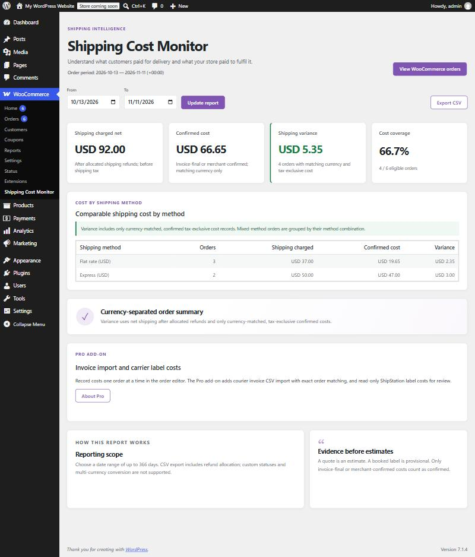
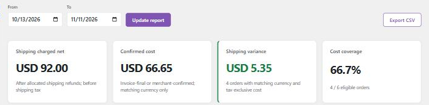
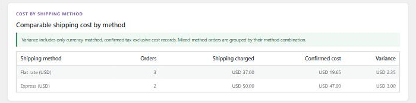
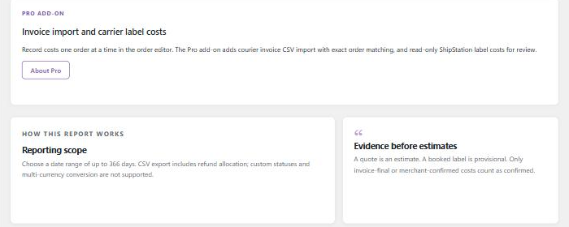

# 4. Reading the dashboard

[← Guide contents](README.md)

Open **WooCommerce → Shipping Cost Monitor**.

## The header

- **Order period** shows the dates being reported and the store time zone, for example `2026-10-13 — 2026-11-11 (+00:00)`.
- **View WooCommerce orders** opens the order list, where you record costs.

## Choosing dates

Set **From** and **To**, then click **Update report**. The default is the last 30 days. The longest range is 366 days. If the dates are invalid or the range is longer, the report shows the default 30 days with the notice **"The selected dates were invalid or exceeded 366 days. Showing the default 30-day period."**

**Export CSV** downloads the same date range. See [chapter 5](05-csv-export.md).

## The four cards

Using the [six example orders](02-key-ideas.md#the-six-example-orders-used-in-this-guide):

### Shipping charged net

What customers paid for shipping on all eligible orders, after shipping refunds, before shipping tax.

`12 + 10 + 15 + 25 + 25 + 5 = USD 92.00`

All eligible orders count here, with or without a cost.

### Confirmed cost

The sum of costs marked **Invoice-final** or **Merchant-confirmed** in the order's currency.

`8.25 + 11.40 + 19.90 + 27.10 = USD 66.65`

Order C has no cost. Order F's 4.00 is a booked label, so it is not confirmed.

### Shipping variance

Net shipping charged minus cost, **only for comparable orders** (A, B, D, E):

| Order | Charged | Cost | Difference |
|---|---|---|---|
| A | 12.00 | 8.25 | +3.75 |
| B | 10.00 | 11.40 | −1.40 |
| D | 25.00 | 19.90 | +5.10 |
| E | 25.00 | 27.10 | −2.10 |
| **Total** | **72.00** | **66.65** | **+5.35** |

So the card reads **USD 5.35** with the note **"4 orders with matching currency and tax-exclusive cost"**.

Note that variance is *not* 92.00 − 66.65 = 25.35. Orders C and F have no comparable cost, so including their shipping charge would invent a profit.

**Colour:** the card turns **green** when variance is positive in every currency (customers paid more than delivery cost) and **red** when it is negative in every currency. With mixed signs across currencies it stays neutral. The sign is always shown too, so colour is never the only clue.

### Cost coverage

How many eligible orders have a confirmed cost in their own currency:

`4 / 6 = 66.7%`

Coverage tells you how complete the report is. Variance on 20% coverage says little about the whole store.

### More than one currency

Each card lists one value per currency, separated by `·`, for example `USD 92.00 · EUR 40.00`. Currencies are never added together.

## Cost by shipping method

One row per shipping method and currency. An order with two shipping methods is grouped under their combination.

| Column | Meaning | Flat rate example |
|---|---|---|
| **Orders** | All eligible orders using this method | 3 (A, B, C) |
| **Shipping charged** | Net shipping on those orders | 37.00 |
| **Confirmed cost** | Comparable cost only | 8.25 + 11.40 = 19.65 |
| **Variance** | Charged minus cost, comparable orders only | (12 − 8.25) + (10 − 11.40) = 2.35 |

The **Shipping charged** column includes order C, but **Variance** does not. Rows are sorted from the worst variance to the best, so loss-making methods appear first. Methods with no comparable cost (Local pickup in the example) are not listed.

## The lower cards

- **Currency-separated order summary** is a reminder of how variance is calculated. When there are no eligible orders it reads **"No eligible shipping orders found"** and explains which orders count.
- **Pro add-on** appears only when Pro is not installed. With Pro active this space shows the invoice import panel ([chapter 6](06-pro-invoice-import.md)).
- **How this report works** and **Evidence before estimates** summarise the rules from [chapter 2](02-key-ideas.md).
