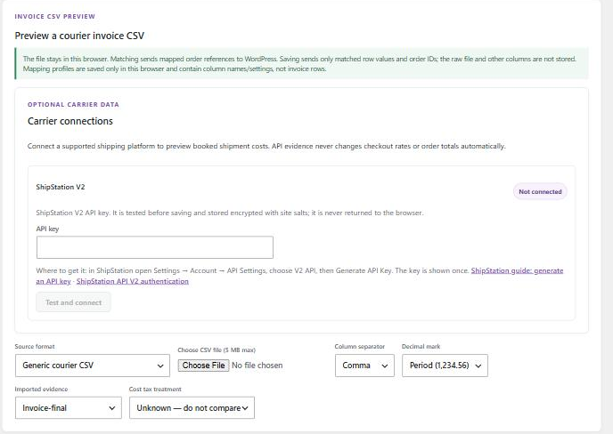
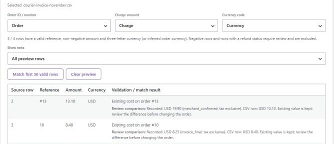

# 6. Pro: importing a courier invoice CSV

[← Guide contents](README.md)

With the Pro add-on active, the dashboard shows **Preview a courier invoice CSV** below the method table. It turns a courier's invoice export into cost records on the matching orders, without retyping.



## Privacy first: where your file goes

The CSV is **read inside your browser**. It is not uploaded or stored on your site.

- **Matching** sends only the order references from the column you mapped.
- **Saving** sends only, for each row you approve: the order ID, the reference, the amount, the currency, the evidence and tax choice, and the row number.
- Other columns (customer names, addresses, tracking numbers in your file) never leave the browser.

## Before you start

You need a CSV file with:

- a **header row** (column names) and at least one data row;
- a column holding the **WooCommerce order number or order ID** for each parcel;
- a column holding the **amount you were charged**.

Limits: 5 MB, 5,000 data rows, 100 columns, 65,536 characters per cell. Split bigger files.

## Step 1: choose the source format

| **Source format** | Use it for |
|---|---|
| **Generic courier CSV** | Any courier invoice. You map the columns yourself. |
| **WooCommerce Shipping label report** | The label report exported from WooCommerce Shipping. Columns are suggested for you, label prices are treated as **Booked label / manifest**, the order currency is used, and rows with a refund status are held for review. |

## Step 2: choose the file

Click **Choose CSV file (5 MB max)** and pick the file. If it cannot be parsed you get a precise message, for example **"The CSV has an unclosed quoted field."** or **"Unexpected text follows a closing quote."** See [troubleshooting](08-troubleshooting.md#invoice-import-messages).

## Step 3: tell the plugin how to read the file

| Control | Choose |
|---|---|
| **Column separator** | **Comma**, **Semicolon** or **Tab**. European exports often use semicolons. |
| **Decimal mark** | **Period (1,234.56)** or **Comma (1.234,56)**. Wrong choice turns 12,50 into 1250. |
| **Order ID / number** | The column with your WooCommerce order number. A leading `#` (for example `#1042`) is removed automatically. |
| **Charge amount** | The column with the charge. |
| **Currency code** | A currency column, or **Use matched order currency** if the file has none. |
| **Imported evidence** | **Invoice-final** for a final invoice; **Booked label / manifest** for a label report; **Merchant-confirmed** if you checked the numbers. |
| **Cost tax treatment** | **Tax-exclusive** if the amount column has no tax. |

Pro pre-selects columns when the header names are familiar (case, spaces and punctuation ignored): **Order ID / number** from `Order`, `Order number` or `Order ID`; **Charge amount** from `Amount`, `Charge`, `Shipping cost`, `Shipping charge`, `Cost`, `Total`, `Price`, `Label price` or `Label cost`; **Currency code** from `Currency`, `Currency code` or `ISO`. Always check the suggestion. If two columns have the same name, they are labelled with their position, for example **Amount (Column 2)** and **Amount (Column 3)**.

The line under the preview says how many rows are valid, for example `18 / 20 rows have a valid reference, non-negative amount and currency`.

### Saving the mapping for next month

Click **Save current mapping** and give it a name. Next time, after choosing a file with exactly the same column names, pick it under **Saved mapping profile** and click **Apply profile**. Profiles are kept **in this browser only** (up to 20) and contain column names and settings, never invoice rows. A different browser or computer will not have them.

## Step 4: match

Click **Match first 50 valid rows**. Each row gets a state:



The **Validation / match result** column shows one of these:

| Shown | Meaning | Saved? |
|---|---|---|
| **Ready to match** | Valid row, not matched yet. | — |
| **Ready to save: #12 (processing)** | Exactly one shipping order has this number, its currency matches and it has no cost yet. | Yes, when you save |
| **Existing cost on order #10** | The order already has a cost. Both values are shown under **Review comparison:**. | No — existing costs are never replaced |
| **Duplicate reference in this file** | The same order appears twice in this file (for example `#12` and `12`). | No — reconcile by hand |
| **No matching shipping order** | No shipping order has this number. | No |
| **More than one order matches** | More than one order has this reference. | No |
| **Currency differs from order (EUR)** | The row's currency is not the order's. | No |
| **Credit/refund needs review** | Negative amount (a courier credit). | No |
| **Refund status needs review** | The file marks the label as refunded or voided. | No |
| **Missing or invalid required value** | Empty reference, unreadable amount or bad currency. | No |

After saving, rows show **Saved**, **Already saved**, **Existing cost kept** or **Duplicate order in this invoice batch; none of its rows were saved.**

Use **Show rows** to filter: **All preview rows**, **Needs review**, **Ready to save** or **Saved**.

Matching works 50 rows at a time. Click it again for the next 50.

## Step 5: save

Click **Save matched costs to orders** and confirm. Only **Ready to save** rows are written. Each saved order gets:

- the amount, currency, evidence and tax treatment you chose;
- the note **"Invoice CSV source row N"**;
- a private order note: **"Shipping cost imported from invoice CSV: 13.10 USD, source row 2 (invoice_final; tax exclusive)."**

Saving the same file twice is safe. Rows already saved show **Already saved** and nothing is written a second time. If two rows in one batch point at the same order, **none** of them is saved and they show **"Duplicate order in this invoice batch; none of its rows were saved."**

Reload the dashboard to see the new totals.

## Example

A courier file:

```
Invoice,Order,Charge,Currency
INV-77,#12,13.10,USD
INV-77,10,8.40,USD
INV-77,99999,5.00,USD
```

When the headers are this clear, Pro picks the columns for you: **Order ID / number** = `Order`, **Charge amount** = `Charge`, **Currency code** = `Currency`. Choose evidence **Invoice-final** and tax **Tax-exclusive**. After **Match**:

- `#12` → **Ready to save: #12 (processing)** (order 12 has no cost yet);
- `10` → **Existing cost on order #10**, showing recorded USD 8.25 against incoming USD 8.40. It is not changed; edit order 10 by hand if the invoice is right;
- `99999` → **No matching shipping order**.

Saving writes one cost, on order 12.
