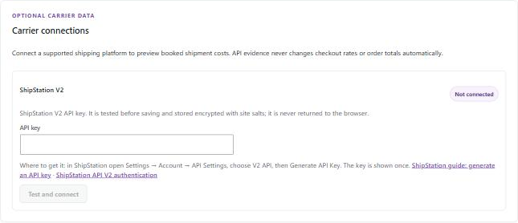

# 7. Pro: ShipStation label costs

[← Guide contents](README.md)

If you buy labels in ShipStation, Pro can read the label prices and send them through the same review-and-match flow as an invoice CSV. It is **read-only**: it never buys, voids or changes labels in ShipStation, and never changes orders on its own.

## Important: label price is not the final bill

ShipStation's `shipment_cost` is the price when the label was bought. Couriers can adjust it later. Pro therefore saves these as **Booked label / manifest**, with tax treatment **Unknown**, so they are visible but **not** counted in confirmed cost or variance. When the courier's invoice arrives, update the cost or import the invoice.

## Step 1: get a ShipStation API V2 key

The links under the key field go straight to these instructions.

1. Sign in to ShipStation.
2. Open **Settings → Account → API Settings**.
3. Under the API version, choose **V2 API**.
4. Click **Generate API Key**. ShipStation shows the key once; copy it.

Official guides: [ShipStation — generate an API key](https://help.shipstation.com/hc/articles/360025856212) and [ShipStation API V2 authentication](https://docs.shipstation.com/authentication). Some plans do not include API access; if **API Settings** is missing, check your ShipStation plan.

## Step 2: connect

1. On the dashboard, find **Carrier connections → ShipStation V2**. The status pill reads **Not connected**.
2. Paste the key into **API key** and click **Test and connect**.
3. Pro sends one read-only request to ShipStation. If ShipStation accepts it, the key is saved and the pill reads **Connected**. If not, nothing is saved and you see the reason, for example **"ShipStation rejected the API key. Check it and reconnect."**

### How the key is stored

- Encrypted with AES-256-GCM, using a key derived from your site's `AUTH_KEY` and `SECURE_AUTH_KEY` in `wp-config.php`.
- Pro refuses to save the key if those are missing or still the default placeholder text.
- The key is never sent back to the browser.
- If you change those salts, the stored key can no longer be opened and the pill reads **Reconnect required**. Connect again.
- **Disconnect** and uninstalling Pro both delete the stored key.

## Step 3: preview labels

1. Choose **From** and **To** (up to 31 days).
2. Click **Preview ShipStation labels**.
3. Up to 100 labels per page appear. Voided labels, return labels and labels without a valid cost are skipped. Click **Load next page** for more.

Nothing is written to WooCommerce at this point.

## Step 4: review and match

Click **Review and match these labels**. The labels move into the [invoice review table](06-pro-invoice-import.md#step-4-match) with source **ShipStation API label preview**. ShipStation's external shipment ID is used as the order reference. Then match and save exactly as for a CSV.

## What is sent to ShipStation

Only to `https://api.shipstation.com/v2/labels`: your API key, the date range, the page number and page size. No customer or order data from your store.

## Messages

| Message | Meaning |
|---|---|
| **ShipStation rejected the API key. Check it and reconnect.** | Wrong, expired or revoked key (HTTP 401). |
| **ShipStation denied access to label data for this account or plan.** | Your plan or user cannot read labels (HTTP 403). |
| **ShipStation rate-limited the request. Wait before syncing again.** | Too many requests (HTTP 429). |
| **Choose a valid date range of 31 days or less.** | Shorten the range. |
| **Connect a ShipStation API key before syncing.** | No key saved. |
| **Add unique AUTH_KEY and SECURE_AUTH_KEY values in wp-config.php before connecting a carrier.** | Your site has no salts or default ones. Ask your host to set them. |
| **Could not reach ShipStation. Check the site connection and try again.** | Network error or timeout (15 seconds). |
