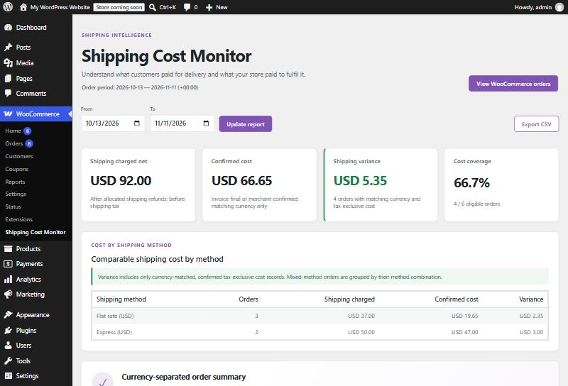

# Shipping Cost Monitor for WooCommerce: user guide

This guide explains every screen, field and number in **Shipping Cost Monitor for WooCommerce** (free) and its **Pro add-on**. It is written for store owners and the people who reconcile courier bills, not for developers. Developer hooks are in the last chapter.

## What the plugin answers

Every order with delivery has two shipping numbers:

1. **What the customer paid you for shipping.** WooCommerce already knows this.
2. **What you paid the courier for that parcel.** WooCommerce does not know this. It arrives later, on a courier invoice or a label bill.

The plugin stores the second number on each order, then reports the difference. A positive difference means customers paid more for shipping than it cost you; a negative difference means you are subsidising delivery.

## Chapters

| # | Chapter | Edition | What you learn |
|---|---|---|---|
| 1 | [Install and first run](01-install.md) | Free, Pro | Requirements, installing both plugins, what you see first |
| 2 | [Key ideas: evidence, tax basis and currency](02-key-ideas.md) | Free, Pro | Why some costs are counted and others are not. Read this before trusting any number |
| 3 | [Recording a cost on an order](03-record-a-cost.md) | Free | Every field in the order editor, with examples |
| 4 | [Reading the dashboard](04-dashboard.md) | Free | Each card and table, with a worked example you can recompute by hand |
| 5 | [Exporting the report as CSV](05-csv-export.md) | Free | Every column, every comparison status, opening it in a spreadsheet |
| 6 | [Pro: importing a courier invoice CSV](06-pro-invoice-import.md) | Pro | Mapping columns, matching orders, review states, saving safely |
| 7 | [Pro: ShipStation label costs](07-pro-shipstation.md) | Pro | Getting the API key, connecting, previewing labels, what is stored |
| 8 | [Troubleshooting and FAQ](08-troubleshooting.md) | Free, Pro | Every message the plugin can show, and what to do |
| 9 | [For developers: hooks and data](09-developers.md) | Free, Pro | Order meta keys, filters and actions, building another add-on |

## Free and Pro at a glance

| Feature | Free | Pro add-on |
|---|---|---|
| Shipping-cost record on each order (amount, currency, evidence, tax basis, note) | Yes | Yes |
| Private order note for every change | Yes | Yes |
| Dashboard: shipping charged, confirmed cost, variance, coverage | Yes | Yes |
| Cost by shipping method | Yes | Yes |
| CSV export without customer personal data | Yes | Yes |
| Courier invoice CSV import with column mapping | — | Yes |
| Exact order matching with duplicate, ambiguous, currency and refund checks | — | Yes |
| Saved column-mapping profiles (kept in your browser) | — | Yes |
| ShipStation V2 label costs (read-only) | — | Yes |
| Calls any external service | Never | Only ShipStation, only after you connect it |

The Pro add-on is a separate plugin that needs the free plugin. Removing Pro never removes the costs it saved; they are ordinary order records that the free plugin keeps reading.

## Conventions in this guide

- **Bold labels** are the exact text on screen.
- Examples use a test store in US dollars with six orders. The same six orders appear in every chapter, so the numbers can be checked against each other.
- "Cost" always means what *you* paid. "Shipping charged" always means what the *customer* paid.
